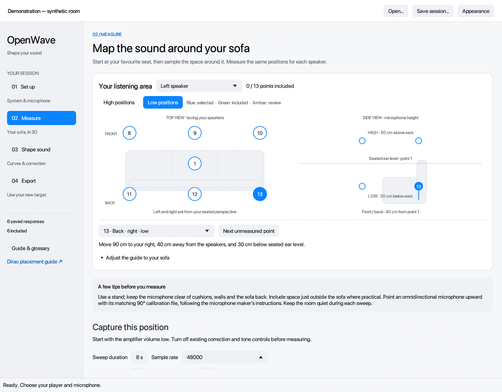
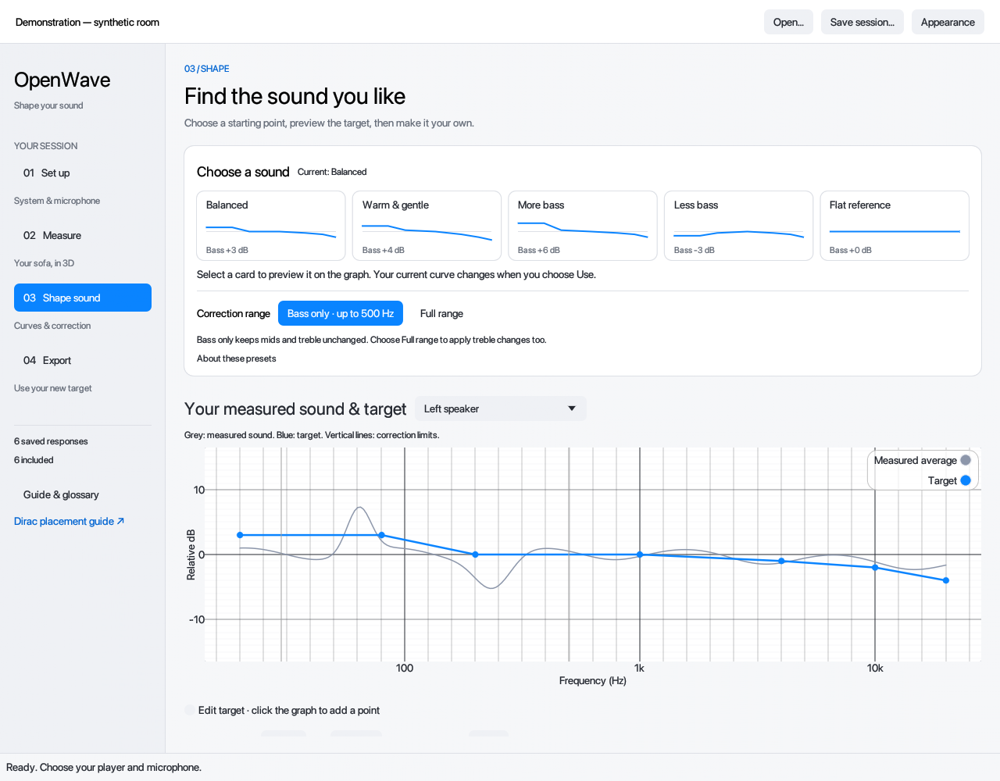

# Guided desktop interface

14 October 2026. The refreshed interface uses one macOS-inspired system across setup, measurement, sound shaping and export. It remains an egui desktop application, with the installed macOS system font, a fixed workflow sidebar, rounded cards, consistent blue actions, light/dark/system themes, plain-language guidance and a scrollable glossary. The bundle is now named `OpenWave.app`; executable, bundle identifier and session suffix stay compatible.

## Measurement guide



The original 13-point sofa plan samples a three-dimensional volume. Point 1 is the main seat at seated ear level. The remaining points combine front/back, left/centre/right, and high/low. Top and side views show the selected point; high/low selectors avoid overlapping numbers. A keyboard-accessible point picker accompanies the clickable diagram. Displayed offsets derive from the adjustable listening area: default 180 cm total width, 40 cm front/back offset and 30 cm height offset. The drawing is schematic, not to scale.

Placement is optional measurement metadata, independent of the imported position index. Captures and WAV analysis record the selected placement. Old and imported measurements stay unassigned until the user explicitly maps them. Included points show green and excluded takes show an amber review outline. Retakes preserve earlier captures; excluding an unwanted take changes averaging. Changing guide dimensions updates the planned layout, not a historical record of exact capture coordinates.

Live measurement now captures a stereo pair at each microphone position: left sweep, then right sweep, with the microphone kept still. Both responses receive the same position and take index. The guide advances after both are saved; progress counts positions with responses from both speakers. The **Review speaker** selector changes the displayed response map without changing output routing or the microphone position. WAV imports still use the reviewed speaker.

The Mac-output route has separate left and right output-channel settings, defaulting to channels 1 and 2; both are checked before playback. The experimental M10 network route captures one speaker at a time automatically and saves separate, uniquely named left/right WAVs in the selected folder. Its existing per-speaker state restoration remains in place. New network responses still require review before averaging. Status identifies which speaker is being measured. **Stop test** cancels the pair; completed responses are preserved, and a failed or stopped pair stays at the same microphone position. Retrying captures another pair and preserves earlier takes.

## Choosing a curve



Five original target presets are available. Levels are relative dB at 20, 80, 200, 1000, 4000, 10000 and 20000 Hz:

| Preset | Levels | Intended starting point |
| --- | --- | --- |
| Balanced | +3, +3, 0, 0, −1, −2, −4 | Everyday listening with gentle warmth |
| Warm & gentle | +4, +4, +1, 0, −2, −4, −6 | Fuller bass and softer treble |
| More bass | +6, +6, +1, 0, −1, −2, −4 | Extra low-frequency weight |
| Less bass | −3, −3, −1, 0, −1, −2, −4 | A lighter low-frequency balance |
| Flat reference | 0, 0, 0, 0, 0, 0, 0 | An even comparison target |

Selecting a card adds an amber preview to the measured/target graph. Applying it changes the shared session target, preserves correction limits and boost, and clears cached filters and native previews. Undo restores the previous target. Bass-only correction selects 30–500 Hz; full range extends to the lower of 20 kHz and 45% of the sample rate. The target's treble slope matters only when included in the correction range. Target levels do not bypass boost limits or establish an achieved acoustic result. Fine point editing, importing curves and all existing export paths remain available.

## Dirac references and boundaries

Direct computer-use access to the installed Dirac Live app was denied, so reference review used the official documentation instead:

- [Dirac Live user manual](https://helpdesk.dirac.com/en/dirac-live/Dirac-Live-User-Manual-1eb2), whose linked PDF is dated June 2022: arrangement, measurement and target-design sections.
- [Dirac measurement order and spacing](https://helpdesk.dirac.com/en/dirac-room-correction/In-what-order-should-I-measure-the-positions-cbe): main position first, varied heights, avoiding obstructions, and spreading points.
- [Dirac measurement count](https://helpdesk.dirac.com/en/dirac-live/How-many-positions-do-I-need-to-measure-a82): completing a measurement arrangement before designing a filter.

The visual design, geometry and presets are independently authored. OpenWave does not implement Dirac auto targets, time alignment or proprietary correction algorithms. No speaker playback, microphone capture or amplifier writes were performed for this interface work.

## Validation

- 84 library tests and 3 GUI tests passed. Added checks cover legacy session loading, placement/dimension persistence, averaging invariance, guide geometry, preset target export/import and FIR generation.
- GUI tests exercise the actual egui preset preview, apply and undo controls, including filter invalidation and preservation of limits.
- All-target Clippy passed with warnings denied.
- All four pages were rendered offline in light and dark appearances, including 980 × 720, the minimum supported window. Paint-output images were inspected; contrast and density were adjusted. The screenshots above are software-rendered egui paint meshes with synthetic data, not a physical display capture or hardware validation.
- The Apple Silicon release was built and its locally ad-hoc signed macOS bundle verified. It is not Developer ID signed or notarized.

To regenerate paint snapshots without opening windows or contacting audio devices:

```sh
OPENWAVE_UI_SNAPSHOTS=/tmp/openwave-ui cargo test --locked --bin open-room
python3 scripts/render-ui-snapshots.py /tmp/openwave-ui
```

The optional snapshot renderer requires NumPy and Pillow. Production and normal tests have no additional dependencies.
